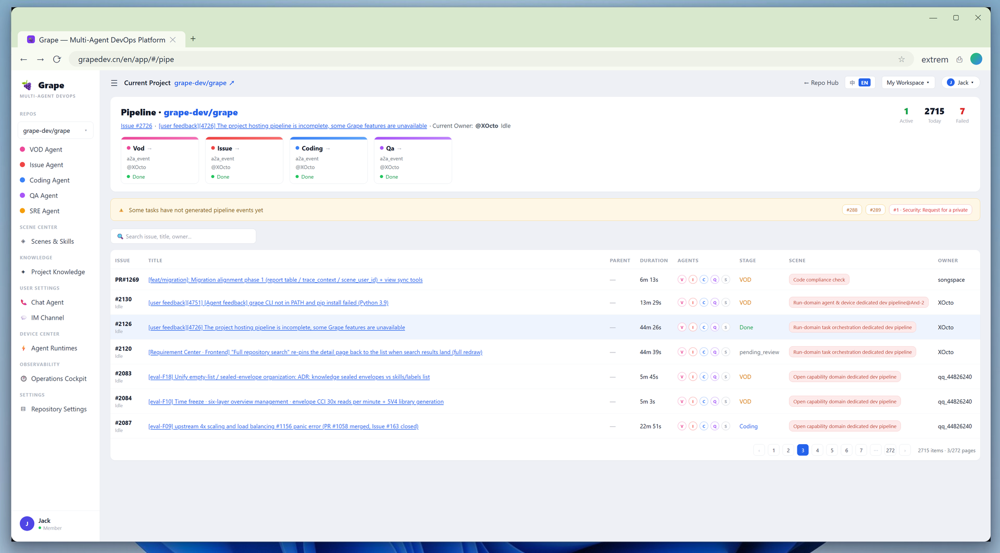
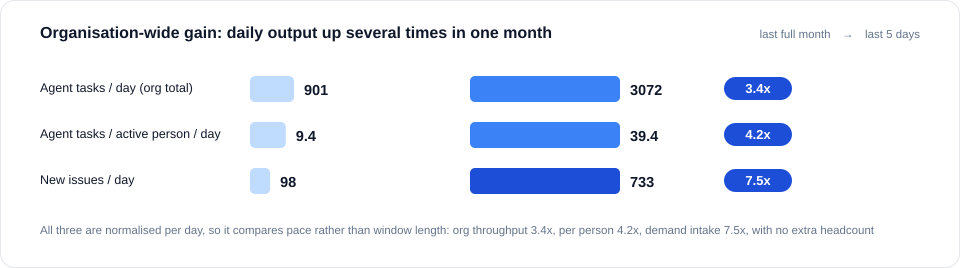
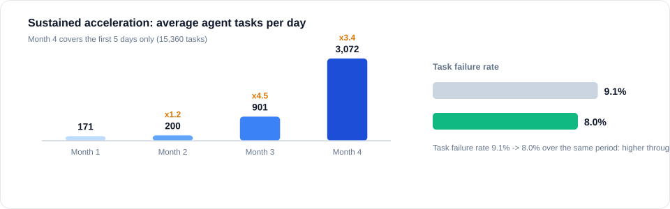
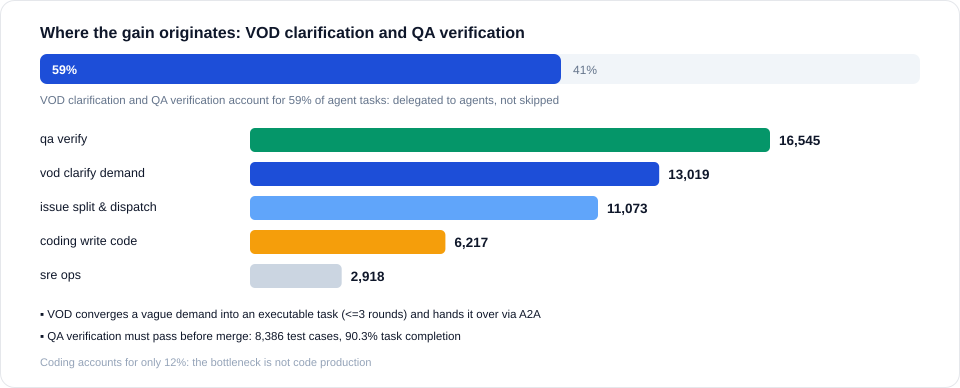

<div align="center">

  <h1><a href="https://www.grapedev.cn/" target="_blank" rel="noopener noreferrer"><picture><source media="(prefers-color-scheme: dark)" srcset="assets/grape-wordmark-dark.png"></picture></a></h1>

  <p>
    <strong>AI Native DevOps —— Turn Any Git Project into an AI-Driven Development Workflow with One Click</strong>
    <br>
    People set requirements and review; agents do the delivery.
  </p>
  <p>
    English / <a href="README.zh.md">中文</a>
  </p>
  <p>
    <a href="https://www.grapedev.cn/">▶ Try it live</a> ·
    <a href="#5-quick-start">Quick start</a> ·
    <a href="https://github.com/grape-dev/grape/issues">Issues</a> ·
    <a href="CONTRIBUTING.md">Contributing</a>
  </p>
  <p>
    <a href="LICENSE"></a>
    <a href="https://github.com/grape-dev/grape/tags"></a>
    <a href="https://github.com/grape-dev/grape/issues"></a>
    <a href="https://github.com/grape-dev/grape/commits/main"></a>
    <a href="https://github.com/grape-dev/grape/graphs/contributors"></a>
  </p>

  <p>
    <a href="https://railway.com/deploy/grape-test?referralCode=25_MLK&utm_medium=integration&utm_source=template&utm_campaign=generic"></a>
  </p>
  <p>
    <span title="Join link coming soon">&nbsp;Feishu</span> ·
    <span title="Join link coming soon">&nbsp;WeChat</span>
  </p>
</div>

---

## 1. What Grape is

Grape turns any Git project into an autonomous AI development team: requirements, implementation, review and deployment are handed off along a single chain of agents, and people only write requirements and review.

**In one line: turn your Git project into an AI-driven autonomous development team.**

<p align="center">
   Issue -> Coding -> QA stages (all done), with the issue/PR task table below showing duration, agents, stage, scene and owner">
</p>

> **Three design principles**
>
> - **The repository is the source of truth** — requirements, decisions, review evidence and delivery records all live in the repo, so context survives personnel changes
> - **AI is a participant in the process** — agents hold roles, context and artifacts, hand over via A2A, and people approve at key points
> - **Experience is an asset** — every run distils experience, decisions and Q&A, recalled by later tasks

## 2. What Grape can do

| Capability | What you get |
| --- | --- |
| **Five-stage agent pipeline** | VOD collects voice and files issues → Issue triages and assigns → Coding implements and opens PRs → QA reviews and scans for security → SRE builds, deploys and operates; the Chat agent answers anytime. Any incoming event runs the whole chain automatically. |
| **One-click hosting for any Git project** | Pick a template or point at an existing repo → the Agent × Skill scene is applied → async onboarding analyses the project and files trial-deployment and exploration issues → from then on every issue / PR is handled automatically. |
| **Skills library** | 15+ official skills across the lifecycle (voice collection, issue management, implementation, PR review, build/deploy/ops, notifications, onboarding), plus custom skills at official / repository / personal level. |
| **Multi-tenant and auditable** | GitHub/GitCode OAuth sign-up, login allowlist, per-user credentials; every agent run is logged (logs, duration, verdict) and traceable in the pipeline. |
| **Pluggable engines** | opencode / codearts and more, chosen by online-healthy-installed. |

## 3. The Problem

Traditional DevOps relies heavily on manual effort across the pipeline: Issues need manual triage, code needs developers to write, PRs need human review, builds and deployments need manual triggers. More projects, more overhead.

Grape's goal is to **AI-ify every one of these steps**, turning developers from executors into decision-makers — you define the direction, AI handles the rest.

| Stage | Traditional | Grape AI Native |
|-------|-----------|-----------------|
| Issue Triage | Manual classification & assignment | VOD / Issue Agent auto-classify & assign |
| Implementation | Developer writes code | Coding Agent auto-implements & submits PR |
| Code Review | Human review | QA Agent auto-review & security scan |
| Build & Deploy | Manual / CI trigger | SRE Agent auto-build, deploy, monitor |
| Requirements | Manual feedback collection | VOD Agent gathers developer voice, clusters insights |

## 4. Efficiency, Measured in Production

### 1. Organisation efficiency - output per unit time

Daily agent tasks across the org rose from 901 to 3,072 (3.4x); per active person from 9.4 to 39.4 (4.2x); demand intake from 98 to 733 issues per day (7.5x). All three are normalised per day and reflect a change in output rhythm rather than in window length.

<p align="center">
   3,072 (3.4x); per active person 9.4 -> 39.4 (4.2x); new issues 98 -> 733 per day (7.5x)">
</p>

### 2. Sustained acceleration - capacity and quality in step

Monthly average agent tasks per day: 171 -> 200 -> 901 -> 3,072, a further 3.4x in the latest period; over the same period the task failure rate fell from 9.1% to 8.0%, so the throughput gain came without a quality regression.

<p align="center">
   200 -> 901 -> 3,072; task failure rate 9.1% -> 8.0%">
</p>

### 3. Where the gain originates - VOD clarification and QA verification

59% of agent tasks sit at the two ends of the pipeline: VOD converges a vague demand into an executable task (<=3 rounds) before handing it over via A2A, and QA verification must pass before merge (8,386 test cases, 90.3% task completion). Coding accounts for only 12%, which indicates the bottleneck is not code production but whether these two ends are delegated to agents.

<p align="center">
  
</p>

## 5. Quick Start

Two install paths — pick one: hand it to an agent, or do it yourself.

<details open>
<summary><strong>① Let an agent install it (recommended)</strong></summary>

Hand the line below to your AI agent and let it handle everything:

```text
Install and start the Grape platform for me by following SETUP.AGENT.md
```

Execution engine and model configuration, hosting your first repository, the preflight check and deployment are covered in **[SETUP.AGENT.md](SETUP.AGENT.md)**.

</details>

<details>
<summary><strong>② Manual installation (one command)</strong></summary>

Install and start — one command does it all:

```bash
git clone https://github.com/grape-dev/grape.git && python grape/quickstart.py
```

Windows PowerShell (5.1 does not support `&&` — use `;` instead):

```powershell
git clone https://github.com/grape-dev/grape.git ; python grape/quickstart.py
```

The first sign-in, platform-facing configuration and deployment are covered in **[SETUP.HUMAN.md](SETUP.HUMAN.md)**.

</details>

### Two required steps (self-hosting)

| Step | If skipped | How |
| --- | --- | --- |
| **Configure OAuth app credentials** | GitCode / GitHub sign-in returns 400 (`not_configured`) and the buttons stay grey | Fill `client_id` / `client_secret` for both providers in `configs/oauth-providers.json`; the callback must be `https://<domain>/api/auth/callback/{gitcode,github}` |
| **Configure the public base URL** | Falls back to `localhost:3000`; OAuth callbacks cannot reach the service and login/hosting fail | Set `server_base_url` and `webhook_url` in `configs/server-config.json` to the public address |

## Community

- **Website**: [grapedev.cn](https://www.grapedev.cn/)
- **Scenes and cases**: [community and use cases](https://www.grapedev.cn/community.html)
- **Feedback**: [Issues](https://github.com/grape-dev/grape/issues)
- **Chat**: <span title="join link coming soon"></span>&nbsp;Feishu · <span title="join link coming soon"></span>&nbsp;WeChat
- **Contributing**: bug fixes, feature requests and new Skills are all welcome — see [CONTRIBUTING.md](CONTRIBUTING.md); contributor list in [Contributors](https://github.com/grape-dev/grape/graphs/contributors)

## Security and privacy

Vulnerability reporting and the security model of agent execution: [SECURITY.md](SECURITY.md).

## License

MIT — see [LICENSE](LICENSE).
