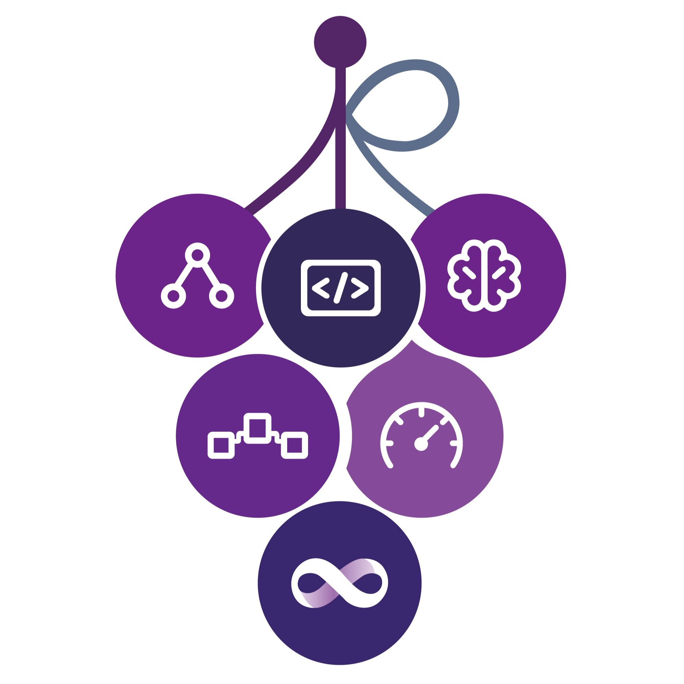
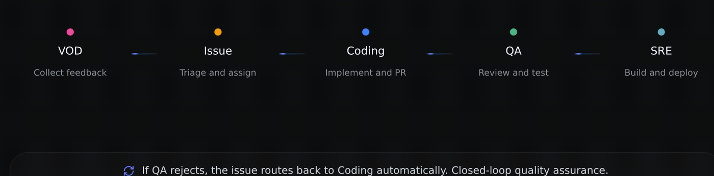

<div align="center">
  

  <h1>Grape</h1>

  <p>
    <strong>AI Native DevOps —— Turn Any Git Project into an AI-Driven Development Workflow with One Click</strong>
    <br>
    No IDE required. Design, develop, test, and ship anywhere, anytime — everyone on your team is a shipper.
  </p>

  <p>
    <a href="LICENSE"></a>
    <a href="https://github.com/gitUser0215/grape/tree/main"></a>
    <a href="https://www.grapedev.cn/"></a>
    
    
    
    <a href="README.zh.md"></a>
  </p>

  <p>
    <a href="https://www.grapedev.cn/">▶ Try it live</a> ·
    <a href="#4-quick-start">Quick start</a> ·
    <a href="CONTRIBUTING.md">Contributing</a> ·
    <a href="README.zh.md">中文</a>
  </p>

  <sub>VOD Agent → Issue Agent → Coding Agent → QA Agent → SRE Agent · + Chat Agent</sub>
</div>



---

## 1. Principles and Value

**From process-driven work where people treat AI as a tool, to workflow-driven collaboration between AI and people** — turn any Git project into a self-evolving AI development workflow: people only create requirements and review; AI completes the journey from requirement to delivery.

| Principle / characteristic | Meaning | How Grape realizes it |
| --- | --- | --- |
| **Repository as first-class citizen** (design premise) | The repository is the source of truth for engineering knowledge: requirements, decisions, review evidence and delivery records are all held by it | Context stays continuous across members, tasks and tools, and does not break with personnel change |
| **End-to-end closed loop, small and lean** | Break down role walls so context flows inside the loop; small closed-loop teams shorten decision chains | One repository is one complete journey: requirement → Coding → QA → SRE hand over inside the same loop, with no cross-role ticketing |
| **Context as an asset** | Decisions, follow-up questions and experience are visible and reusable across members, tasks and tools; organizational memory becomes explicitly manageable | Decisions, Q&A and task summaries persist on the repository and are searchable across sessions |
| **AI is a primary participant in the process** | A peer execution unit: assigned tasks, orchestrated into the delivery chain, collaborating with other agents through structured interfaces | Agents hold a role, input, context and artifact, hand over via A2A, and people approve at key points |
| **Experience flywheel** | Every run makes the organization smarter; the platform asynchronously distils experience, decisions and question–answer pairs | Those three asset types persist on the repository and are recalled by relevance into later tasks |

### Value proposition

Grape redefines the software development workflow — no longer "human-driven with AI assistance", but "AI-driven, human-reviewed".

| # | Core Value | Description |
| --- | --- | --- |
| **1** | **One-Click AI Hosting, Autonomous Evolution** | Connect any Git project to Grape, and the full pipeline from requirements to delivery is driven by Multi-Agent handoff. Issues auto-triage, code auto-implemented, PRs auto-reviewed, builds auto-deployed — iteration velocity **skyrockets**. |
| **2** | **No IDE, Anywhere Full-Stack R&D** | Feishu or WebUI becomes your development interface. Design, develop, test, ship — no editor required. Everyone on the team can directly contribute to delivery. |
| **3** | **Open Source as Templates, Instant Experience & Customization** | Every open-source project in the community is your starting template. One-click creation, auto-deployment for experience, Skill-driven customization — an AI development workflow from 0 to 1, ready instantly. |

## 2. Core Features

| # | Core features | Description |
| --- | --- | --- |
| 1 | **Managed from the moment it enters the repository** | The VOD agent clusters feedback into issues; the Issue agent classifies and assigns them |
| 2 | **Agent-to-agent handoff** | The five-stage pipeline hands over via A2A — no manual routing or status synchronization |
| 3 | **Closed verification loop** | A QA rejection returns the issue to Coding; the quality gate is enforced by the workflow |
| 4 | **Human holds the gate** | Approvals and releases at key stages are decided by a person |
| 5 | **Multi-engine broadcast** | One task runs in parallel across several engines; the best artifact is selected automatically |
| 6 | **Flywheel assets** | Decisions, Q&A and task summaries persist on the repository, recalled by later tasks |
| 7 | **Full observability** | Task centre, pipeline timeline, agent status and health are inspectable |
| 8 | **IM-native collaboration** | Requirements, approvals and progress in Feishu; the Chat Agent is the entry point |

## 3. Problems Addressed

Grape orchestrates multiple AI agents that hand work over to one another, so the repetitive steps of the development workflow complete autonomously. Once a traditional Git project is connected, it gains a complete AI development workflow — requirement clarification, implementation, review and verification, build and deployment — AI Native end to end.

These stages complete without human execution, which leaves developers as decision-makers: define direction, review outcomes.

| Stage | Traditional workflow | Grape AI Native workflow |
| --- | --- | --- |
| Requirement collection | Manual feedback aggregation | VOD Agent gathers developer voice and clusters it |
| Issue handling | Manual triage, labelling, assignment | VOD / Issue Agent classify and assign automatically |
| Implementation | Developers code by hand | Coding Agent implements and opens a PR |
| Code review | Human review | QA Agent reviews and runs security scans |
| Build and deployment | Manual / CI trigger | SRE Agent builds, deploys and operates |

## 4. Quick Start

Two install paths — pick one: hand it to an agent, or do it yourself.

<details open>
<summary><strong>① Let an agent install it (recommended)</strong></summary>

Hand the line below to your AI agent and let it handle everything:

```text
Install and start the Grape platform for me by following https://github.com/gitUser0215/grape/blob/main/SETUP.AGENT.md
```

Execution engine and model configuration, hosting your first repository, the preflight check and deployment are covered in **[SETUP.AGENT.md](SETUP.AGENT.md)**.

</details>

<details>
<summary><strong>② Manual installation (one command)</strong></summary>

```bash
uvx grape-quickstart init
```

One command does it all: fetch the source into `~/.grape/src` → probe the environment → install dependencies → start in the background → wait for a health check (`http://localhost:3000/api/health` returning 200 means success).

**If GitHub is slow from your network**, pull the source from the GitCode mirror:

```bash
uvx grape-quickstart init --repo https://gitcode.com/grape-dev/grape.git
```

The first sign-in, platform-facing configuration and deployment are covered in **[SETUP.HUMAN.md](SETUP.HUMAN.md)**.

</details>

## Community

- **Issues** — https://github.com/gitUser0215/grape/issues
- **Feishu** — feedback in your bound group chat after connecting Grape
- **Community** — https://www.grapedev.cn/community.html

## Security

Vulnerability reporting and the security model of agent execution: [SECURITY.md](SECURITY.md).

## License

MIT — see [LICENSE](LICENSE).
