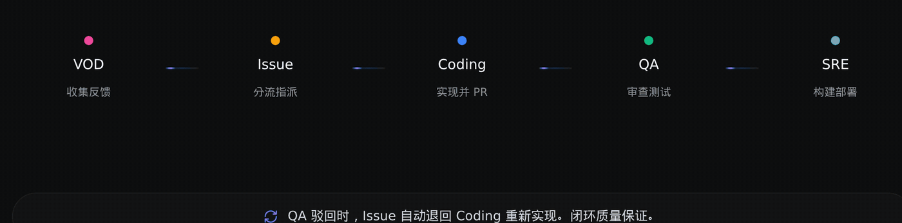

<div align="center">
  

  <h1>Grape</h1>

  <p>
    <strong>AI Native DevOps —— 将任意 Git 项目一键变为 AI 自主驱动的开发工作流</strong>
    <br>
    无需 IDE，随处设计、开发、测试、发布——让团队每个人都是交付者
  </p>

  <p>
    <a href="LICENSE"></a>
    <a href="https://github.com/gitUser0215/grape/tree/main"></a>
    <a href="https://www.grapedev.cn/"></a>
    
    
    
    <a href="README.md"></a>
  </p>

  <p>
    <a href="https://railway.com/deploy/grape-test?referralCode=25_MLK&utm_medium=integration&utm_source=template&utm_campaign=generic"></a>
  </p>

  <p>
    <a href="https://www.grapedev.cn/">▶ 立即体验</a> ·
    <a href="#四快速开始">快速开始</a> ·
    <a href="CONTRIBUTING.md">参与贡献</a> ·
    <a href="README.md">English</a>
  </p>

  <sub>VOD Agent → Issue Agent → Coding Agent → QA Agent → SRE Agent · + Chat Agent</sub>
</div>



---

## 一、理念与价值

**从「流程驱动人把 AI 当工具」到「工作流驱动 AI 和人协作」** —— 把任意 Git 项目变成可自主演进的 AI 开发工作流：人只做需求创建与 Review，AI 完成从需求到交付的端到端旅程。

| 理念与特征 | 含义 | 在 Grape 中的体现 |
| --- | --- | --- |
| **代码仓第一等公民**（设计原点） | 仓是工程知识的事实来源：需求、决策、评审证据与交付记录都由仓持有 | 上下文跨成员、跨任务、跨工具连续，不因人员变动断档 |
| **端到端闭环 · 短小精简** | 打破角色墙，让上下文在闭环内流动；以小型闭环团队为单位，决策链条大幅缩短 | 一个仓即一条完整旅程：需求 → Coding → QA → SRE 在同一闭环内交接，无跨角色提单 |
| **上下文即资产** | 决策、反问、经验跨成员、跨任务、跨工具可见可复用，组织记忆可被显式管理 | 决策、问答与任务摘要沉淀在仓上，跨会话可查 |
| **AI 是流程的主要参与者** | 与人并列的执行单元：被分配任务、被编排进交付链路、以结构化接口与其他 Agent 协同 | Agent 有角色、输入、上下文与产物，经 A2A 交接；人在关键节点审批放行 |
| **经验飞轮** | 每跑一次任务，组织变聪明一次；平台异步提炼经验、决策、反问 Q&A 三类资产 | 三类资产沉淀在仓上，由后续任务按相关性召回注入 |

### 价值主张

Grape 重新定义了软件开发工作流——不再是"人驱动 AI 辅助"，而是"AI 驱动、人把关"。

| # | 核心价值 | 说明 |
| --- | --- | --- |
| **1** | **一键 AI 托管，项目自主演进** | 将任意 Git 项目接入 Grape 后，从需求到落地的全流程由 Multi-Agent 接力驱动。Issue 自动分诊、代码自动实现、PR 自动审查、构建自动部署——项目迭代速度**跃升**。 |
| **2** | **无需 IDE，随时随地的研发全流程** | 飞书 / WebUI 即开发入口。设计、开发、测试、发布——无需打开编辑器，团队每个人都能直接参与交付。 |
| **3** | **开源即模板，快速体验与二次开发** | 社区海量开源项目都是你的项目模板。一键创建、自动体验部署、Skill 驱动二次开发——从 0 到 1 的 AI 开发工作流即刻就绪。 |

## 二、核心特性

| # | 核心特性 | 说明 |
| --- | --- | --- |
| 1 | **需求入仓即托管** | VOD 聚类反馈建单，Issue 自动分诊与指派 |
| 2 | **Agent 间自主交接** | 五段流水线经 A2A 交接，无需人工路由与状态同步 |
| 3 | **验证闭环** | QA 驳回退回 Coding 重做，质量门由流程保证 |
| 4 | **人在环上把关** | 关键节点的审批与放行由人决定 |
| 5 | **多引擎广播** | 同一任务并行多引擎执行，自动择优 |
| 6 | **飞轮资产** | 决策、问答与任务摘要留在仓上，由后续任务按相关性召回 |
| 7 | **全程可观测** | 任务中心、流水线时间线、Agent 状态与健康度可查 |
| 8 | **IM 原生协同** | 飞书内提需求、审批、看进展；Chat Agent 承接会话入口 |

## 三、解决的问题

Grape 通过多个 AI Agent 自主协作，让开发工作流中的重复环节全部交由 AI 接力完成。一个传统 Git 项目接入 Grape 后，即获得完整的 AI 开发工作流——从需求澄清、代码实现、审查验证到构建部署，全流程 AI Native。

这些环节交由 AI 完成，开发者从执行者转变为决策者：定义方向、Review 结果。

| 环节 | 传统工作流 | Grape AI Native 工作流 |
| --- | --- | --- |
| 需求收集 | 人工汇总反馈 | VOD Agent 收集开发者声音并聚类提炼 |
| Issue 处理 | 人工分诊、标签、指派 | VOD / Issue Agent 自动分类、分派 |
| 代码实现 | 开发者手动编码 | Coding Agent 自动实现并提交 PR |
| 代码审查 | 人工 Review | QA Agent 自动审查与安全扫描 |
| 构建部署 | 手动 / CI 触发 | SRE Agent 自动构建、部署与运维 |

## 四、快速开始

两种装法，任选其一 —— 交给 Agent，还是自己动手。

<details open>
<summary><strong>① 让 Agent 装（推荐）</strong></summary>

把下面这句丢给你的 AI Agent，让它全程搞定：

```text
按 https://github.com/gitUser0215/grape/blob/main/SETUP.AGENT.md 里的步骤为我安装 Grape 平台并启动
```

执行引擎与模型配置、托管首个仓库、环境自检、上线部署等其余事项，见 **[SETUP.AGENT.md](SETUP.AGENT.md)**。

</details>

<details>
<summary><strong>② 人工安装（一条命令）</strong></summary>

```bash
uvx grape-quickstart init
```

一条命令完成：拉取源码到 `~/.grape/src` → 环境探测 → 安装依赖 → 后台启动 → 健康检查（`http://localhost:3000/api/health` 返回 200 即成功）。

**国内网络访问 GitHub 慢**，源码改走 GitCode 镜像：

```bash
uvx grape-quickstart init --repo https://gitcode.com/grape-dev/grape.git
```

首次登录、平台对外配置、上线部署等其余事项，见 **[SETUP.HUMAN.zh.md](SETUP.HUMAN.zh.md)**。

</details>

## 社群

- **Issues** —— https://github.com/gitUser0215/grape/issues
- **飞书** —— 接入 Grape 后可在绑定群内直接反馈
- **社群** —— https://www.grapedev.cn/community.html

## 安全

漏洞上报与 Agent 执行安全模型见 [SECURITY.md](SECURITY.md)。

## 许可

MIT，见 [LICENSE](LICENSE)。
