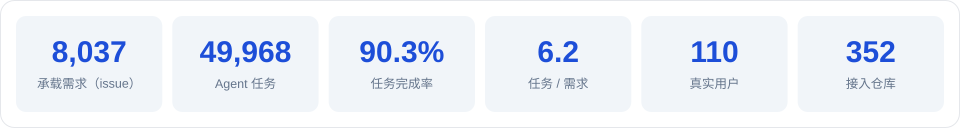
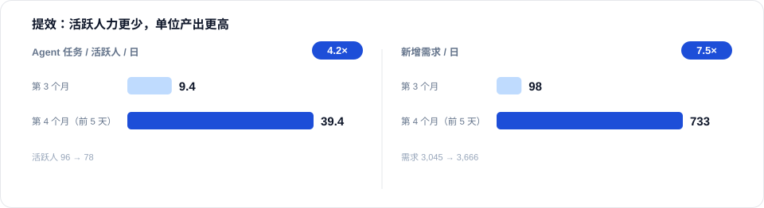
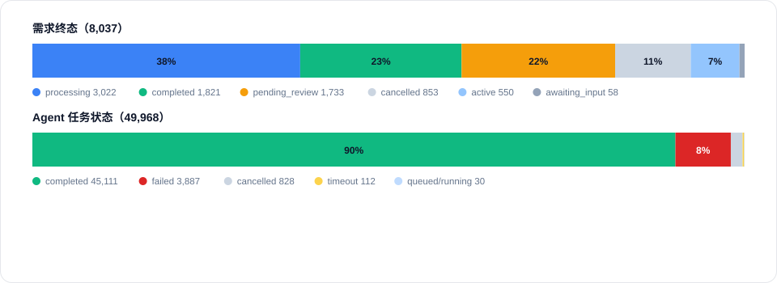
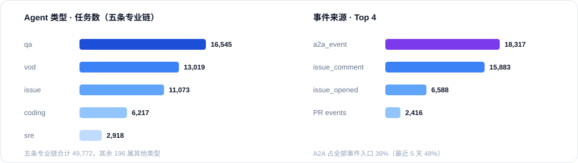
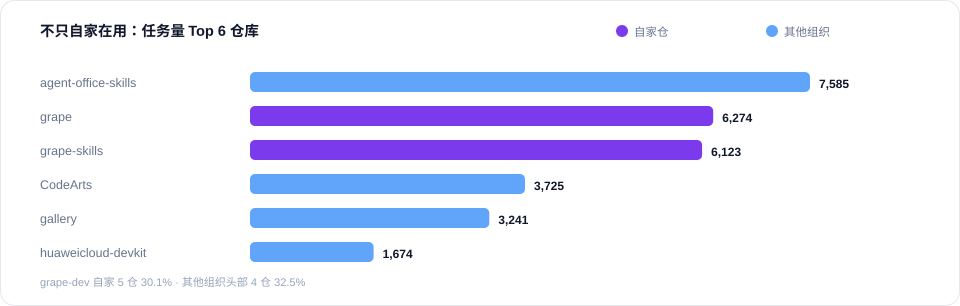

<div align="center">

  <h1><a href="https://www.grapedev.cn/" target="_blank" rel="noopener noreferrer"><picture><source media="(prefers-color-scheme: dark)" srcset="assets/grape-wordmark-dark.png"></picture></a></h1>

  <p>
    <strong>AI Native DevOps —— 将任意 Git 项目一键变为 AI 自主驱动的开发工作流</strong>
    <br>
    人只管需求与 Review，其余交给 Agent
  </p>
  <p>
    <a href="README.md">English</a> / 中文
  </p>
  <p>
    <a href="https://www.grapedev.cn/">▶ 立即体验</a> ·
    <a href="#五快速开始">快速开始</a> ·
    <a href="https://github.com/grape-dev/grape/issues">Issues</a> ·
    <a href="CONTRIBUTING.zh.md">参与贡献</a> ·
    <span title="入群入口筹备中">&nbsp;飞书</span> ·
    <span title="入群入口筹备中">&nbsp;微信</span>
  </p>
  <p>
    <a href="LICENSE"></a>
    <a href="https://github.com/grape-dev/grape/tags"></a>
    <a href="https://github.com/grape-dev/grape/issues"></a>
    <a href="https://github.com/grape-dev/grape/commits/main"></a>
    <a href="https://github.com/grape-dev/grape/graphs/contributors"></a>
  </p>

  <p>
    <a href="https://railway.com/deploy/grape-test?referralCode=25_MLK&utm_medium=integration&utm_source=template&utm_campaign=generic"></a>
  </p>
</div>

---

## 一、Grape 是什么

Grape 把任意 Git 项目变成一支 AI 自主开发团队：需求、实现、审查、部署由多个 Agent 在同一条链上接力完成，人只写需求和做 Review。

**一句话：把你的 Git 项目变成 AI 驱动的自主开发团队。**

> **三条设计原则**
>
> - **仓是事实来源** —— 需求、决策、评审证据、交付记录都落在仓上，人员变动也不断档
> - **AI 是流程参与者** —— Agent 有角色、有上下文、有产物，彼此经 A2A 交接，人在关键节点放行
> - **经验是资产** —— 每跑一次任务，经验、决策与问答即沉淀，并被后续任务按相关性召回

## 二、Grape 能做什么

| 能力 | 具体结果 |
| --- | --- |
| **五段 Agent 流水线** | VOD 收集声音建单 → Issue 分类指派 → Coding 编码提 PR → QA 审查与安全扫描 → SRE 构建部署运维；Chat Agent 随时问答。事件进来即自动贯穿全流程。 |
| **一键托管任意 Git 项目** | 选模板或喂现有仓库 → 自动套用「Agent × Skill」场景 → 异步首次引导（分析项目、建体验部署与探索 Issue）→ 此后每个 Issue / PR 自动处理。 |
| **Skills 技能库** | 15+ 官方技能覆盖全流程（声音收集、Issue 管理、代码实现、PR 审查、构建部署运维、通知、托管引导），支持官方 / 仓库级 / 个人级三态自定义。 |
| **多租户与可审计** | GitCode OAuth 动态建号、登录白名单、凭据按用户隔离；每次 Agent 执行留痕（日志 / 耗时 / 结论），Pipeline 可追踪。 |
| **引擎可插拔** | opencode / codearts 等多后端切换，按 online-healthy-installed 选型。 |

## 三、解决的问题

传统 DevOps 中，从需求到发布的大量工作依赖人工：Issue 要手动分诊打标签、代码要开发自己写、PR 要人肉 Review、构建部署要手动触发。项目越多，人力成本越高。

Grape 的目标是将这些环节**全部 AI 化**，让开发者从执行者变为决策者——只需定义方向、Review 结果。

| 环节 | 传统工作流 | Grape AI Native 工作流 |
|------|-----------|----------------------|
| Issue 处理 | 人工分诊、标签、指派 | VOD / Issue Agent 自动分类、分派 |
| 代码实现 | 开发者手动编码 | Coding Agent 自动实现 + 提交 PR |
| 代码审查 | 人工 Review | QA Agent 自动审查 + 安全扫描 |
| 构建部署 | 手动 / CI 触发 | SRE Agent 自动构建、部署、运维 |
| 需求收集 | 人工汇总反馈 | VOD Agent 收集开发者声音、聚类提炼 |

## 四、提效实测

<p align="center">
  
</p>

<p align="center">
  
</p>

<p align="center">
  
</p>


- **人效与吞吐**：活跃人从 96 降到 78，每人每日 Agent 任务却从 9.4 升到 39.4（4.2×）；每日新增需求从 98 升到 733（7.5×）
- **质量与协作**：失败率 9.1% → 8.0%；A2A 派活占比 39% → 48%，近一半的活由 Agent 派给 Agent

<p align="center">
  
</p>

<p align="center">
  
</p>

<p align="center">
  
</p>


## 五、快速开始

两种装法，任选其一 —— 交给 Agent，还是自己动手。

<details open>
<summary><strong>① 让 Agent 装（推荐）</strong></summary>

把下面这句丢给你的 AI Agent，让它全程搞定：

```text
按 https://github.com/gitUser0215/grape/blob/main/SETUP.AGENT.md 里的步骤为我安装 Grape 平台并启动
```

执行引擎与模型配置、托管首个仓库、环境自检、上线部署等其余事项，见 **[SETUP.AGENT.md](SETUP.AGENT.md)**。

</details>

<details>
<summary><strong>② 人工安装（一条命令）</strong></summary>

安装并启动，一个命令搞定：

```bash
git clone https://github.com/grape-dev/grape.git && python grape/quickstart.py
```

Windows PowerShell（5.1 不支持 `&&`，用 `;` 代替）：

```powershell
git clone https://github.com/grape-dev/grape.git ; python grape/quickstart.py
```

首次登录、平台对外配置、上线部署等其余事项，见 **[SETUP.HUMAN.zh.md](SETUP.HUMAN.zh.md)**。

</details>

### 装完必做两步（自建部署）

| 步骤 | 不做的后果 | 怎么做 |
| --- | --- | --- |
| **配置 OAuth 应用凭据** | GitCode / GitHub 登录返回 400（`not_configured`），登录按钮灰 | `configs/oauth-providers.json` 填两个 provider 的 `client_id` / `client_secret`，回调须为 `https://<域名>/api/auth/callback/{gitcode,github}` |
| **配置对外可访问基址** | 回退 `localhost:3000`，OAuth 回调无法回访，登录与托管不可用 | `configs/server-config.json` 的 `server_base_url` 与 `webhook_url` 改成对外地址 |

## 社群

- **Issues** —— https://github.com/grape-dev/grape/issues
- &nbsp;**飞书** —— 入群入口筹备中，开放后在此更新（接入 Grape 后也可在绑定的群内直接反馈）
- &nbsp;**微信** —— 入群入口筹备中，开放后在此更新
- **社群** —— https://www.grapedev.cn/community.html

## 安全

漏洞上报与 Agent 执行安全模型见 [SECURITY.md](SECURITY.md)。

## 许可

MIT，见 [LICENSE](LICENSE)。
